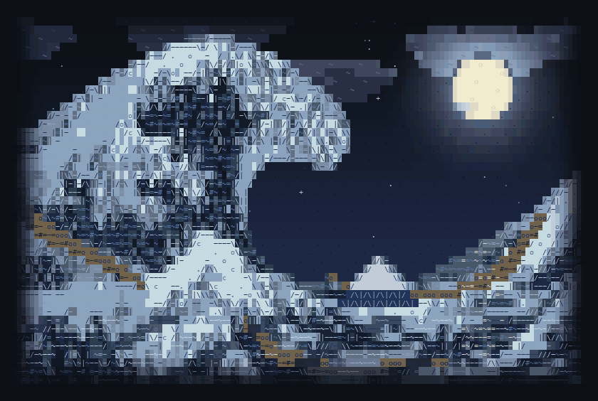

  

# Nick Pearlstone
CS major at Cornell Engineering.

### Current Project:
[Hydro-Knight](https://github.com/nickpearlstone/Hydro-Knight) — pose-based drowning detection
### Contact
[LinkedIn](https://www.linkedin.com/in/nick-p-387048361)
